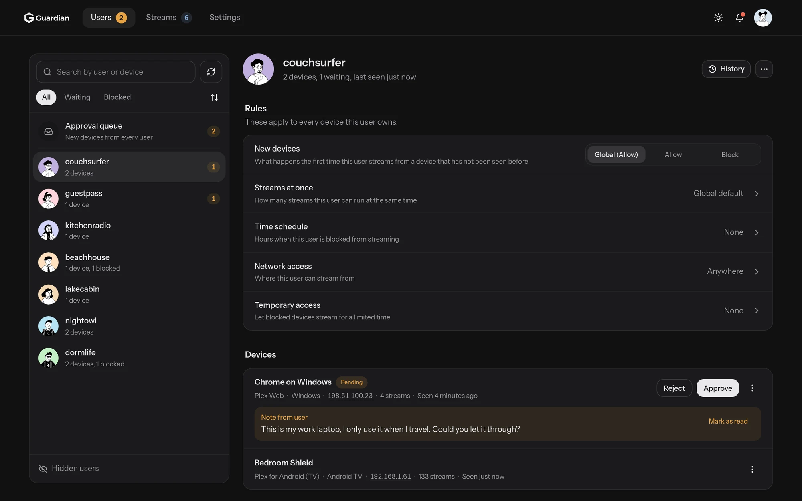
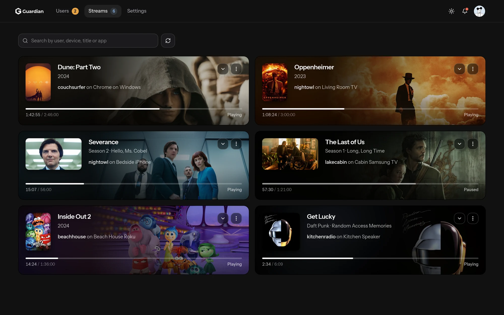
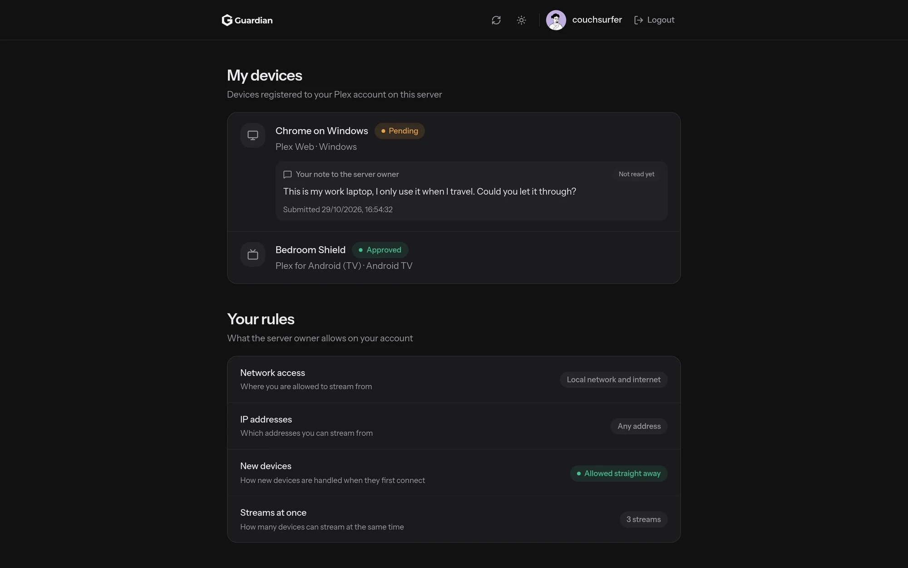
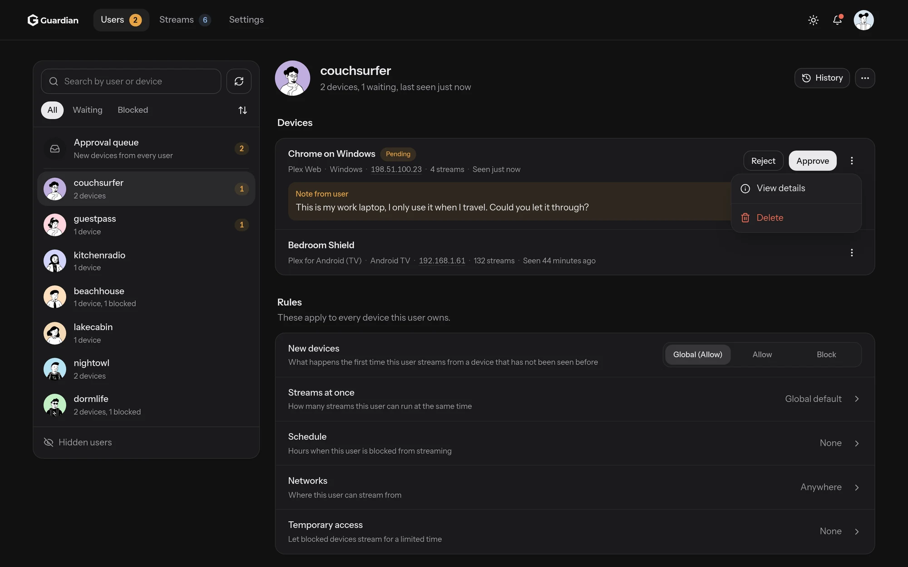
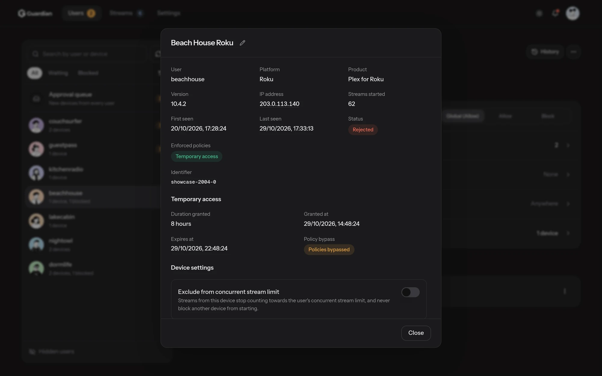
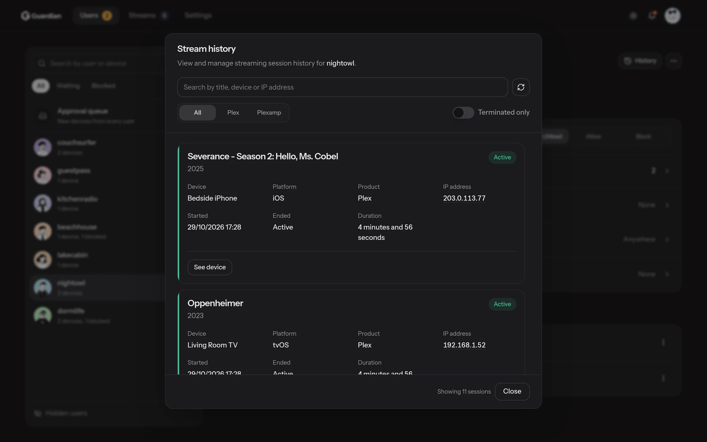
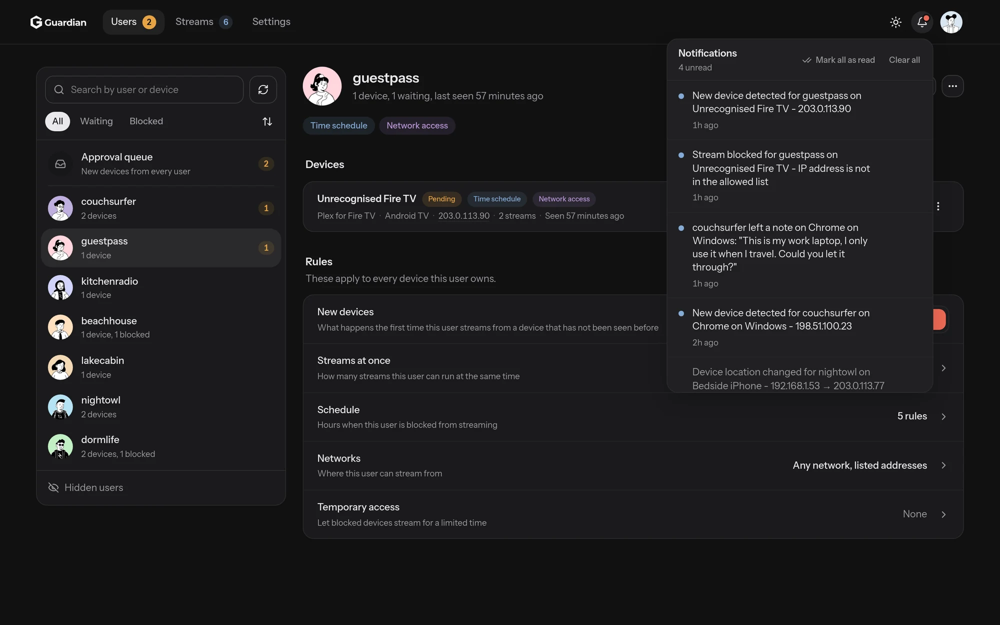
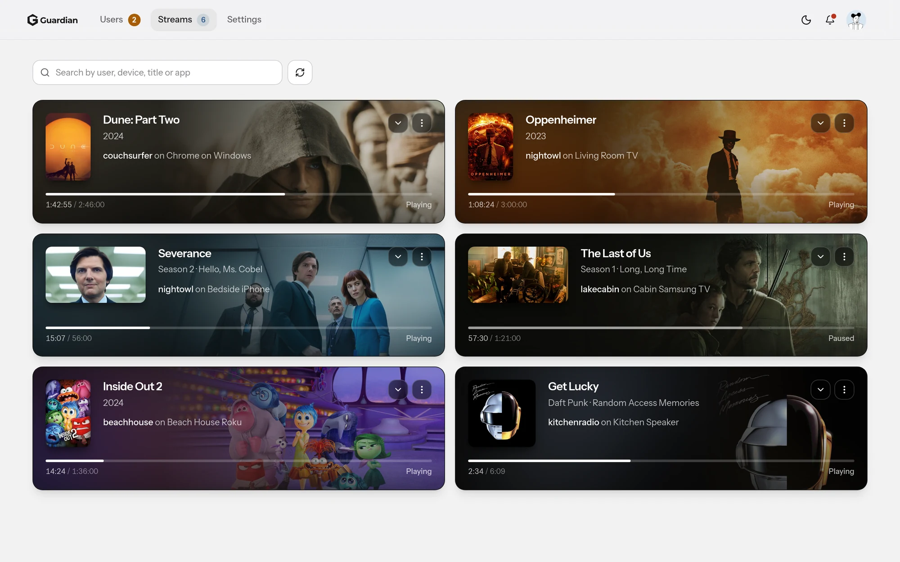

# Guardian

[](https://github.com/HydroshieldMKII/Guardian/actions/workflows/ci.yml)
[](https://github.com/HydroshieldMKII/Guardian/actions/workflows/cd.yml)
[)](https://hub.docker.com/r/hydroshieldmkii/guardian)
[](https://github.com/HydroshieldMKII/Guardian/stargazers)


Guardian is an access-control layer for Plex Media Server. It polls the Plex sessions API, matches each stream against per-user and per-device policy, and terminates the sessions that fail.

> [!NOTE]
> Still on V1? Update your Compose file: see the [v2.0.0 release notes](https://github.com/HydroshieldMKII/Guardian/releases/tag/v2.0.0).





<details>
<summary>More screenshots</summary>













</details>

## Features

- Approve, reject or hold devices, with per-user overrides, LAN/WAN and IP allowlists, schedules and temporary grants
- Global and per-user concurrent stream limits
- Live sessions, stream details and searchable history
- Email, Apprise and in-app notifications
- A portal where Plex users see their own devices and leave notes

## Install

Requires a reachable Plex Media Server and a [Plex token](https://support.plex.tv/articles/204059436-finding-an-authentication-token-x-plex-token/).

```bash
mkdir -p guardian && cd guardian
curl -o docker-compose.yml https://raw.githubusercontent.com/HydroshieldMKII/Guardian/main/docker-compose.example.yml
docker compose up -d
```

The web UI listens on port 3000. On Unraid, create a stack from `docker-compose.example.yml` under **Docker → Compose**.

## Updating

Export your settings first (**Settings → Admin Tools → Export Settings**), then:

```bash
docker compose pull && docker compose up -d
```

Image tags and downgrades: see [Configuration](docs/CONFIGURATION.md#image-tags).

## Documentation

[Configuration](docs/CONFIGURATION.md) · [Troubleshooting](docs/TROUBLESHOOTING.md) · [Contributing](CONTRIBUTING.md) · [Releasing](docs/RELEASING.md) · [Security](SECURITY.md)

## License

[PolyForm Noncommercial 1.0.0](LICENSE.md)
